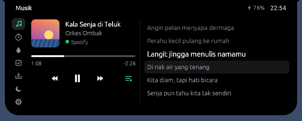
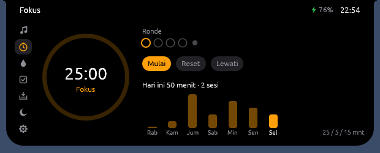
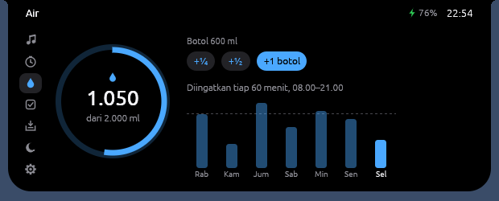
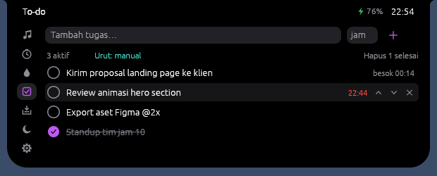
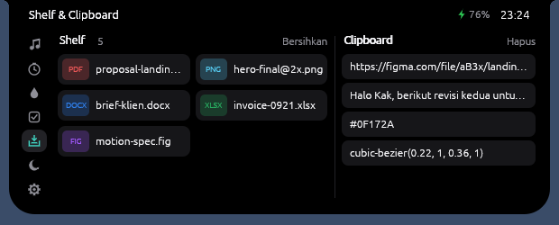
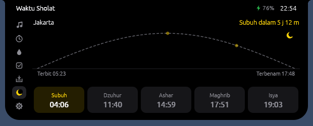
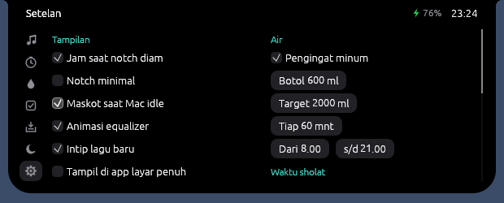
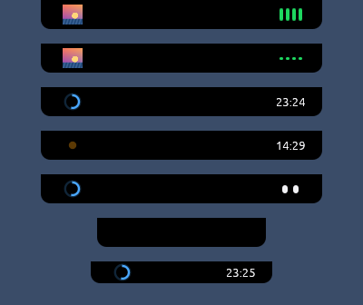
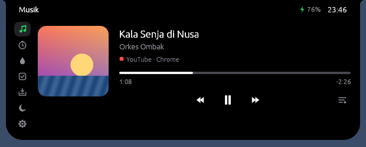

# Nusa — notch hidup untuk macOS

Nusa mengubah notch MacBook (atau bagian tengah atas layar di Mac tanpa notch) menjadi
"pulau" kecil yang membesar saat di-hover. Isinya: musik + lirik tersinkron, timer fokus,
pengingat minum, to-do, shelf file, riwayat clipboard, waktu sholat, baterai, dan maskot.

Ditulis dengan **Rust**, digambar langsung lewat GPU (egui + OpenGL). Tidak ada webview atau
Electron, dan proses benar-benar tidur saat tidak ada yang berubah.

| | |
|---|---|
|  |  |
|  |  |
|  |  |
|  |  |

Keadaan tertutup (musik diputar, jeda, jam + cincin air, timer fokus, maskot idle, notch polos, Mac tanpa notch):



---

## Fitur

| Fitur | Keterangan |
|---|---|
| **Musik** | Spotify & Apple Music: judul, artis, sampul, progress, play/pause/next/prev, seek dengan klik/seret. Klik sampul untuk ganti pemutar. |
| **Musik dari browser** | YouTube, YouTube Music, SoundCloud, Spotify Web & Apple Music Web di **Chrome, Arc, Edge, Brave, Safari**: judul, artis/channel, sampul, progress, kontrol & lirik. Lihat [Musik dari browser](#musik-dari-browser). |
| **Lirik tersinkron** | Dari [LRCLIB](https://lrclib.net) (gratis). Baris aktif disorot; klik baris untuk lompat. Hanya judul, artis, album & durasi yang dikirim. |
| **Fokus (Pomodoro)** | Cincin waktu, ronde dalam satu siklus, istirahat pendek/panjang, riwayat 7 hari. Titik "bernapas" di notch saat berjalan. |
| **Pengingat air** | Ukuran botol, target harian, interval, jam aktif. Grafik 7 hari dengan garis target. |
| **To-do** | Tenggat jam (mis. `14:30`), urut manual (↑↓) atau berdasarkan waktu, notch memberi tahu saat jatuh tempo. Klik ganda (atau ikon pensil) untuk mengedit teks & jam; Enter simpan, Esc batal. |
| **Shelf file** | Seret file ke notch, lalu seret keluar ke Finder/Slack/Mail. Klik ganda untuk buka, klik kanan untuk Finder/Salin/Hapus. |
| **Riwayat clipboard** | Teks yang disalin muncul di samping shelf. Klik untuk salin lagi, atau seret ke app lain. Isi dari password manager (penanda `org.nspasteboard.ConcealedType`) **tidak** direkam. |
| **Waktu sholat** | Dihitung lokal tanpa internet, metode Kemenag RI (Subuh 20°, Isya 18°, Ashar Syafi'i). Diuji terhadap jadwal resmi Jakarta: selisih < 1 menit. Busur matahari, pengingat X menit sebelumnya, opsi jeda musik saat adzan. 30 kota + koordinat bebas. |
| **Baterai** | Notifikasi saat charger dicolok/dicabut, peringatan 20% & 10%. |
| **Maskot** | Setelah Mac idle 1 menit, jam diganti sepasang mata yang berkedip. Setelah 10 menit ia tertidur, dan menyapa saat kamu kembali. |
| **Cincin status** | Progres air atau baterai di samping jam. |
| **Mode minimal** | Notch tertutup hanya menampilkan aktivitas (musik/timer), tanpa jam. |
| **Layar penuh** | Default: Nusa menyingkir saat ada app layar penuh. |
| **Start saat login** | Lewat LaunchAgent. |

Semua data (to-do, log air, shelf, setelan) tersimpan lokal di
`~/Library/Application Support/Nusa/data.json`. Tidak ada akun dan tidak ada analytics.

## Kenapa Rust, bukan Go

- **Tanpa garbage collector.** RAM stabil dan tidak ada jeda GC, jadi animasi tidak patah-patah.
- **Binding AppKit kelas satu** lewat `objc2`. Go butuh cgo + Objective-C manual.
- **UI ringan.** Toolkit GUI Go (Fyne, Wails/webview) jauh lebih berat untuk window kecil yang selalu tampil.
- Nusa versi Windows juga ditulis dengan Rust.

## Kenapa ringan

- **Reactive rendering.** egui hanya menggambar ulang saat ada event atau jadwal: menit berganti,
  timer, pengingat, atau baris lirik berikutnya. Di antara itu proses tidur (diuji: ~0% CPU saat diam).
- **Event-driven, bukan polling:**
  - Musik: *distributed notifications* dari Spotify/Apple Music.
  - Hover: monitor mouse global yang hanya membangunkan UI saat kursor melewati batas notch.
  - Monitor dicolok/dicabut: notifikasi `NSApplicationDidChangeScreenParameters`.
  - Polling hanya ada di dua tempat yang memang tidak punya event di macOS: clipboard
    (`changeCount` tiap 0,8 dtk, satu integer) dan baterai (tiap 20 dtk).
  - Musik dari browser: AppleScript hanya berjalan saat browser terbuka, dengan jeda adaptif
    (5 dtk saat musik diputar, 8 dtk saat dijeda, 15 dtk bila tak ada tab musik). Hanya tab
    situs musik yang disentuh. Bisa dimatikan di Setelan → "Musik dari browser".
  - Satu-satunya animasi berulang adalah equalizer di notch tertutup saat lagu diputar
    (±1% CPU). Bisa dimatikan di Setelan → "Animasi equalizer".
- **Klik tembus.** Di luar bentuk notch, window mengabaikan mouse, jadi menu bar tetap bisa diklik.
- **Tanpa stack TLS di binary.** HTTP (lirik & sampul) memakai `/usr/bin/curl` bawaan macOS.
- **GPU terintegrasi** (`NSSupportsAutomaticGraphicsSwitching`): tidak memaksa GPU diskrit di MacBook Pro dual-GPU.
- Sampul diperkecil jadi thumbnail 160 px. Font memakai SF Pro sistem (tidak dibundel).
- Build release: LTO + `panic=abort` + strip.

---

## Install

### Cara termudah — klik dua kali `Buat-DMG.command` di Mac

1. Ekstrak zip, buka foldernya di Finder.
2. **Klik kanan `Buat-DMG.command` → Open → Open** (klik kanan diperlukan sekali karena file
   berasal dari internet).
3. Terminal terbuka dan otomatis:
   - meminta install *Xcode Command Line Tools* bila belum ada (sekali saja),
   - menginstal Rust bila belum ada (sekali saja, ±2 menit),
   - mem-build Nusa dan membuat **`dist/Nusa-0.1.0.dmg`**, lalu membuka foldernya.
4. Buka DMG → seret **Nusa** ke **Applications**.

Build pertama ±3–6 menit (mengunduh & mengompilasi dependensi); berikutnya < 1 menit.

### Opsi A — Build otomatis di GitHub (tanpa install apa pun)

1. Push folder ini ke repo GitHub.
2. Tab **Actions** → workflow **Build macOS** berjalan otomatis (runner `macos-14`).
3. Unduh artifact **Nusa-macOS** → `Nusa-0.1.0.dmg` (universal: Apple Silicon + Intel).
4. Push tag `v0.1.0` untuk membuat GitHub Release berisi DMG.

### Opsi B — Build lokal di Mac

```bash
# sekali saja
xcode-select --install
curl --proto '=https' --tlsv1.2 -sSf https://sh.rustup.rs | sh

# build .app + .dmg (universal)
./scripts/bundle-macos.sh
# lebih cepat, hanya Apple Silicon:
ARCH=arm64 ./scripts/bundle-macos.sh

open dist/Nusa.app
```

Untuk development: `cargo run` (jalan tanpa bundle; Dock icon tetap disembunyikan).

### Musik dari browser



Agar Nusa bisa membaca progres & sampul serta mengontrol pemutaran, izinkan JavaScript dari
Apple Events **sekali** di browser yang Anda pakai:

| Browser | Menu |
|---|---|
| Chrome / Edge / Brave | **View → Developer → Allow JavaScript from Apple Events** |
| Arc | **View → Developer → Allow JavaScript from Apple Events** (menu Arc disembunyikan: tekan ⌥ atau buka lewat Command Bar) |
| Safari | **Settings → Advanced → centang "Show features for web developers"**, lalu **Settings → Developer → Allow JavaScript from Apple Events** |

Tanpa itu, Nusa tetap menampilkan **judul tab** saja (beserta petunjuk di notch).
Saat pertama kali, macOS juga akan bertanya *"Nusa ingin mengontrol Google Chrome / Safari"* → **OK**.

Yang dibaca hanyalah tab dengan URL situs musik di atas; isi tab lain tidak disentuh.
Firefox belum didukung (tidak menyediakan AppleScript untuk tab).

### Pertama kali dibuka

- **Gatekeeper.** App ditandatangani ad-hoc (belum Developer ID), jadi macOS akan menolak saat
  dibuka pertama kali. Klik kanan **Nusa.app → Open → Open**, atau:
  `xattr -dr com.apple.quarantine /Applications/Nusa.app`
- **Izin Automation.** Saat pertama memutar lagu, macOS bertanya *"Nusa ingin mengontrol Spotify / Music"*.
  Pilih **OK**. Bisa diubah di System Settings → Privacy & Security → Automation.
- Tidak perlu izin Accessibility atau Screen Recording.

Untuk distribusi publik: `SIGN_ID="Developer ID Application: Nama (TEAMID)" ./scripts/bundle-macos.sh`,
lalu notarize dengan `xcrun notarytool`.

---

## Batasan versi 0.1

- **Musik dari browser** hanya untuk situs & browser yang tercantum di atas; Firefox dan app
  lain (VLC, Podcasts, dll.) belum didukung. Status dari browser diperbarui tiap 5–15 detik
  (posisi di antaranya diperkirakan), jadi pergantian lagu bisa tampil beberapa detik terlambat.
- **Belum ada:** halaman notifikasi, overlay volume/kecerahan/Caps Lock (macOS sudah punya HUD
  sendiri), alert Wi-Fi/earbuds, widget, gaya floating/glass.
- Shelf menampilkan badge jenis file, bukan thumbnail (sengaja, demi RAM).
- Jadwal sholat memakai zona waktu sistem. Pilih kota di zona waktu yang sama dengan Mac.

## Struktur kode

```
src/
  main.rs            entry point, opsi window (transparan, tanpa dekorasi)
  app.rs             inti: bentuk & animasi notch, hover/klik-tembus, pengingat, jadwal repaint
  views/             music · focus · water · todo · shelf · prayer · settings
  platform/macos.rs  AppKit via objc2: level window, monitor mouse, notifikasi musik,
                     AppleScript, clipboard, drag & drop native, idle time, LaunchAgent
  platform/stub.rs   pengganti untuk Linux (development & preview)
  media.rs           model "now playing", parser LRC, klien LRCLIB, pembersih judul YouTube
  browser.rs         AppleScript + JavaScript untuk tab musik di browser (+ tes)
  prayer.rs          perhitungan waktu sholat (+ test terhadap jadwal Kemenag)
  store.rs           data lokal (JSON)
  shared.rs          state dari thread latar → UI; thread baterai
  theme.rs           warna, ikon vektor, helper teks
  demo.rs            data contoh untuk preview (NUSA_DEMO=1)
packaging/           Info.plist, ikon
scripts/             bundle-macos.sh (.app + .dmg)
.github/workflows/   build DMG di runner macOS
```

### Preview di Linux (tanpa Mac)

```bash
cargo test                               # termasuk uji akurasi waktu sholat
cargo check --features macos-check       # type-check modul macOS (objc2 + GNUstep, tanpa link)
NUSA_DEMO=1 NUSA_BG=1 NUSA_TAB=lyrics cargo run
# NUSA_TAB   = music|lyrics|focus|water|todo|shelf|prayer|settings
# NUSA_STATE = expanded|collapsed|peek|auto     NUSA_EARS = music|focus|clock|none
```
